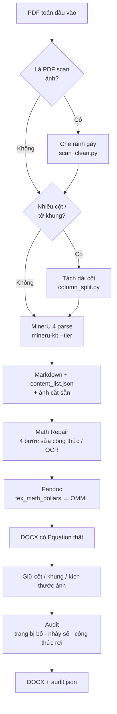
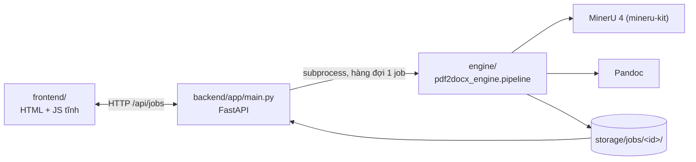

# MatchPDF

## NGHIÊN CỨU, CẢI TIẾN KHẢ NĂNG XỬ LÝ VÀ TRÍCH XUẤT NỘI DUNG CÔNG THỨC TOÁN TỪ TÀI LIỆU PDF

**Môn học:** Công nghệ lập trình hiện đại — SGU, HK1 2026–2027

---

## 1. Vấn đề nghiên cứu

PDF giữ được hình dạng trang in nhưng gần như không chỉnh sửa lại được. Với tài liệu toán, **công thức** là phần hỏng đầu tiên khi chuyển định dạng, vì PDF không lưu "công thức" — nó chỉ lưu từng ký tự ở một toạ độ.

Một pipeline ngây thơ (trích text → đổi đuôi thành `.docx`) hỏng ở sáu điểm, và đó chính là sáu nhóm cải tiến của đồ án:

| Nhóm lỗi | Biểu hiện thực tế |
|---|---|
| Cấu trúc trang | Cheat sheet nhiều cột bị đọc thành **một bảng khổng lồ**, mất thứ tự đọc theo cột |
| Nhiễu từ bản scan | Ảnh chụp sách lộ **trang bên kia** qua rãnh gáy → chèn dòng cụt vào giữa đề bài |
| Công thức bị xé | `x$^{7}$` tách rời thành chữ `x` + công thức `$^{7}$` → Word hiện "x ⁷" lệch font |
| Ký hiệu LaTeX lạ | `{\bf X}` khiến Pandoc không hiểu → công thức **rơi về text thô**, không thành Equation |
| Công thức quá cao | Hệ phương trình nằm inline bị Word **cắt mất dòng đầu** |
| Không kiểm soát được | Không biết trang nào bị bỏ, chỗ nào mất công thức — lỗi âm thầm |

Mục tiêu của đồ án: **đo được** chất lượng trích xuất, không chỉ "trông giống PDF".

---

## 2. Cải tiến đã cài đặt

Tất cả các bước dưới đây chạy **offline**, không cần GPU, không viết cứng cho một file PDF cụ thể — mọi ngưỡng đều dò từ chính hình học / lớp chữ của PDF đầu vào.

### 2.1. Tiền xử lý trang

| Cải tiến | Cách làm | File |
|---|---|---|
| Che rãnh gáy bản scan | Dò cột tối hẹp có phía ngoài sáng hơn hẳn → tô trắng phần ngoài rãnh | `engine/src/pdf2docx_engine/pdf/scan_clean.py` |
| Tách dải cột cho cheat sheet | Dò đường kẻ dọc dài gần bằng đường dài nhất → cắt thành các dải, cho MinerU đọc từng cột như tài liệu 1 cột | `engine/src/pdf2docx_engine/pdf/column_split.py` |
| Chạy song song | Chia PDF thành N dải trang liên tiếp, N tiến trình MinerU cùng lúc, ghép lại theo `page_idx` | `engine/src/pdf2docx_engine/recognition/parallel_mineru.py` |

### 2.2. Sửa công thức trên Markdown

`engine/src/pdf2docx_engine/math/math_repair.py` chạy 4 bước thuần regex + thống kê:

1. **`merge_fragmented_math`** — gộp `x$^{7}$` → `$x^{7}$`, `(1+x)$^{11}$` → `$(1+x)^{11}$`.
2. **`fix_problem_labels`** — dựa vào dãy số thứ tự liên tiếp của đề bài để sửa `nǐ 52`, `Bai 52`, `Pai 54` → `Bài 52.`, `Bài 53.`, `Bài 54.`
3. **`fix_diacritics_by_context`** — bỏ phiếu theo ngữ cảnh toàn tài liệu + từ điển thuật ngữ toán: `Tím hệ số` → `Tìm hệ số`.
4. **`promote_tall_inline_math`** — công thức inline có hệ/ma trận nhiều dòng → display math, tránh Word cắt dòng đầu.

### 2.3. Dựng DOCX giữ đúng hình dạng PDF

| Cải tiến | Cách làm | File |
|---|---|---|
| Equation OMML thật | Pandoc với `tex_math_dollars` → `m:oMath`, công thức chỉnh sửa được trong Word | `engine/src/pdf2docx_engine/docx/build_docx.py` |
| Chuẩn hoá LaTeX legacy | `{\bf X}` → `\mathbf{X}` trước khi Pandoc đọc | `engine/src/pdf2docx_engine/docx/build_docx.py` |
| Giữ bố cục nhiều cột | Đặt section N cột + chèn ngắt cột đúng chỗ mỗi cột PDF kết thúc | `engine/src/pdf2docx_engine/docx/columns.py` |
| Giữ khung + tiêu đề mục | Dựng lại viền trang, kẻ cột, banner lặp đầu trang, thanh tiêu đề mục | `engine/src/pdf2docx_engine/docx/frame_layout.py` |
| Kích thước ảnh đúng PDF | MinerU cắt ảnh ở 200 dpi nhưng Pandoc đoán 96 dpi → ảnh to gấp ~2 lần; thêm `{width=..in}` | `engine/src/pdf2docx_engine/docx/image_size.py` |

### 2.4. Kiểm soát chất lượng

`engine/src/pdf2docx_engine/audit.py` chạy ba phép kiểm tra sau khi dựng DOCX và ghi `audit.json`:

- **`dropped_pages`** — đọc log MinerU, tìm trang bị `dropped=N` (khối nội dung bị bỏ).
- **`numbering_gaps`** — phát hiện đề bài / ý nhỏ nhảy số (`Bài 53` mất, `11a) 11c)` thiếu `b)`).
- **`docx_math_failures`** — quét `document.xml`, tìm LaTeX còn sót thành chữ thường (`\frac`, `\left`, `$`) = công thức Pandoc không đổi được.

Điểm cốt lõi: hệ thống **không** đoán công thức từ ảnh OCR thô. Nó lấy `content_list.json` của MinerU (đã có `type`, `page_idx`, `bbox`, LaTeX) làm nguồn sự thật duy nhất, rồi dựng cả DOCX lẫn báo cáo kiểm tra từ cùng nguồn đó.

---

## 3. Luồng xử lý





---

## 4. Model và công nghệ đang chạy

Số liệu đo trực tiếp trên máy phát triển ngày 2026-10-26.

| Thành phần | Đang dùng | Phiên bản | Vai trò |
|---|---|---|---|
| Parse PDF | MinerU `mineru-kit` | **4.0.12** | Markdown, `content_list.json`, cắt ảnh |
| Tier parse | `standard` | — | Cân bằng tốc độ / chất lượng công thức |
| Thiết bị suy luận | `mps` | — | Apple Silicon GPU |
| Worker | 2 tiến trình song song | — | Chia dải trang, chạy đồng thời |
| Công thức → Word | Pandoc `texmath` | **3.11** | LaTeX → OMML Equation |
| Sửa lỗi công thức | Regex + thống kê tự cài | — | Không model, không GPU |
| Runtime | Python | **3.13.14** | |

**Kiểm chứng lại:**

```bash
.venv/bin/mineru-kit version     # → MinerU version: 4.0.12
pandoc --version | head -1       # → pandoc 3.11
python3 --version                # → Python 3.13.14
```


---

## 5. Cấu trúc repo

```text
engine/                      Lõi xử lý, không phụ thuộc web
  src/pdf2docx_engine/
    pipeline.py              convert(pdf, out_dir) + CLI
    config.py                tier MinerU, cờ Pandoc, thư mục storage
    audit.py                 kiểm tra chất lượng -> audit.json
    pdf/                     scan_clean, column_split (tiền xử lý PDF)
    recognition/             run_mineru, parallel_mineru (OCR), diacritic_fusion + vision_ocr.swift (ghép OCR), vi_correct
    math/                    math_repair (sửa công thức trên Markdown)
    docx/                    build_docx, columns, frame_layout, image_size
  tests/
backend/                     FastAPI mỏng: nhận PDF, chạy engine, trả DOCX
  app/main.py
  tests/
frontend/                    index.html + app.js + style.css, không build step
storage/                     Kết quả chạy (bị gitignore)
```

Engine không biết gì về web; backend chỉ gọi `python -m pdf2docx_engine.pipeline` như người dùng gõ trong terminal, nên mọi kết quả trên UI đều tái lập được bằng CLI.

---

## 6. Cách chạy

Cần sẵn: Python ≥ 3.10, `pandoc`, `tesseract` (dò cột), MinerU 4 (`mineru-kit`).

PDF scan: mặc định Tesseract (`vie`) + Apple Vision (macOS, tự biên dịch `vision_ocr.swift` bằng `swiftc`) bỏ phiếu sửa chữ
MinerU đọc sai (`recognition/diacritic_fusion.py`). Đo trên 2 trang AAA gõ tay làm đáp án: sai 8,72% → 0,59%.
Cài: `brew install tesseract tesseract-lang` (Windows: cài Tesseract + gói `vie`, chỉ dùng Tesseract). Tắt: `--no-ocr-fusion`
(ra y hệt `main.py` nhánh kiet).

```bash
python -m venv .venv && source .venv/bin/activate
pip install -r requirements.txt -r backend/requirements.txt   # requirements.txt = của nhánh kiet
export PYTHONPATH=$PWD/engine/src                              # hoặc: pip install --no-deps -e engine

# CLI
python -m pdf2docx_engine.pipeline --pdf bai_giang.pdf          # -> storage/runs/<ten>_<doc_id>/
python -m pdf2docx_engine.pipeline --pdf bai_giang.pdf --tier standard --workers 1 --out /tmp/x
python -m pdf2docx_engine.pipeline --pdf bai_giang.pdf --vi-correct   # sửa dấu tiếng Việt

# Web: backend phục vụ luôn frontend/
uvicorn backend.app.main:app --port 8000                        # mở http://127.0.0.1:8000

# Test
pytest engine/tests backend/tests
```

| Method | Đường dẫn | Mô tả |
|---|---|---|
| `POST` | `/api/jobs` | multipart `file` (PDF ≤ 80 MB), `tier`, `workers` (1–4) → job `queued` |
| `GET` | `/api/jobs` | Danh sách job, mới nhất trước |
| `GET` | `/api/jobs/{id}` | Trạng thái + 80 dòng log cuối + `audit.json` |
| `GET` | `/api/jobs/{id}/docx` | Tải DOCX khi `status = done` |

Job chạy tuần tự (MinerU ngốn RAM/CPU). Mỗi job nằm trong `storage/jobs/<id>/` (`input.pdf`, `job.json`, `log.txt`, `out/`); id được kiểm bằng regex nên không path traversal được.

---

## 7. Giới hạn đã biết

- **Rãnh gáy:** chỉ bắt được trường hợp có rãnh tối rõ. Chữ lộ qua giấy ở mép **không** có rãnh tối (đã thử trên 95 trang `Toan11`: che được 47 trang) thì chưa tách được bằng heuristic đơn giản.
- **Chưa có ground truth** trong repo nên chưa có số CER/WER/PER của đồ án.
- **Công thức mờ / mất nét** trong bản scan có thể không phục hồi được. Hệ thống ghi cảnh báo vào `audit.json` thay vì tự bịa nội dung.
- **Phụ thuộc bên ngoài:** thiếu `pypdfium2`/`pdftoppm`, `tesseract` hoặc `opencv` thì bước dò cột tự rơi về chế độ "chia cột liên tục", không báo lỗi.
