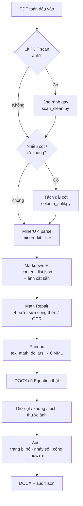
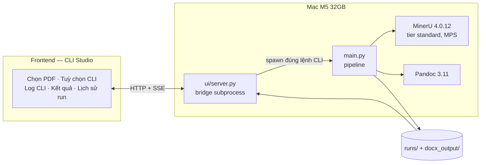

# MatchPDF

## NGHIÊN CỨU, CẢI TIẾN KHẢ NĂNG XỬ LÝ VÀ TRÍCH XUẤT NỘI DUNG CÔNG THỨC TOÁN TỪ TÀI LIỆU PDF

**Môn học:** Công nghệ lập trình hiện đại — SGU, HK1 2026–2027

---

## 1. Vấn đề nghiên cứu

PDF giữ được hình dạng trang in nhưng gần như không chỉnh sửa lại được. Với tài liệu toán, **công thức** là phần hỏng đầu tiên khi chuyển định dạng, vì PDF không lưu "công thức" — nó chỉ lưu từng ký tự ở một toạ độ.

Một pipeline ngây thơ (trích text → đổi đuôi thành `.docx`) hỏng ở sáu điểm, và đó chính là sáu nhóm cải tiến của đồ án:

| Nhóm lỗi | Biểu hiện thực tế |
|---|---|
| Cấu trúc trang | Cheat sheet nhiều cột bị đọc thành **một bảng khổng lồ**, mất thứ tự đọc theo cột |
| Nhiễu từ bản scan | Ảnh chụp sách lộ **trang bên kia** qua rãnh gáy → chèn dòng cụt vào giữa đề bài |
| Công thức bị xé | `x$^{7}$` tách rời thành chữ `x` + công thức `$^{7}$` → Word hiện "x ⁷" lệch font |
| Ký hiệu LaTeX lạ | `{\bf X}` khiến Pandoc không hiểu → công thức **rơi về text thô**, không thành Equation |
| Công thức quá cao | Hệ phương trình nằm inline bị Word **cắt mất dòng đầu** |
| Không kiểm soát được | Không biết trang nào bị bỏ, chỗ nào mất công thức — lỗi âm thầm |

Mục tiêu của đồ án: **đo được** chất lượng trích xuất, không chỉ "trông giống PDF".

---

## 2. Cải tiến đã cài đặt

Tất cả các bước dưới đây chạy **offline**, không cần GPU, không viết cứng cho một file PDF cụ thể — mọi ngưỡng đều dò từ chính hình học / lớp chữ của PDF đầu vào.

### 2.1. Tiền xử lý trang

| Cải tiến | Cách làm | File |
|---|---|---|
| Che rãnh gáy bản scan | Dò cột tối hẹp có phía ngoài sáng hơn hẳn → tô trắng phần ngoài rãnh | `src/scan_clean.py` |
| Tách dải cột cho cheat sheet | Dò đường kẻ dọc dài gần bằng đường dài nhất → cắt thành các dải, cho MinerU đọc từng cột như tài liệu 1 cột | `src/column_split.py` |
| Chạy song song | Chia PDF thành N dải trang liên tiếp, N tiến trình MinerU cùng lúc, ghép lại theo `page_idx` | `src/parallel_mineru.py` |

### 2.2. Sửa công thức trên Markdown

`src/math_repair.py` chạy 4 bước thuần regex + thống kê:

1. **`merge_fragmented_math`** — gộp `x$^{7}$` → `$x^{7}$`, `(1+x)$^{11}$` → `$(1+x)^{11}$`.
2. **`fix_problem_labels`** — dựa vào dãy số thứ tự liên tiếp của đề bài để sửa `nǐ 52`, `Bai 52`, `Pai 54` → `Bài 52.`, `Bài 53.`, `Bài 54.`
3. **`fix_diacritics_by_context`** — bỏ phiếu theo ngữ cảnh toàn tài liệu + từ điển thuật ngữ toán: `Tím hệ số` → `Tìm hệ số`.
4. **`promote_tall_inline_math`** — công thức inline có hệ/ma trận nhiều dòng → display math, tránh Word cắt dòng đầu.

### 2.3. Dựng DOCX giữ đúng hình dạng PDF

| Cải tiến | Cách làm | File |
|---|---|---|
| Equation OMML thật | Pandoc với `tex_math_dollars` → `m:oMath`, công thức chỉnh sửa được trong Word | `src/build_docx.py` |
| Chuẩn hoá LaTeX legacy | `{\bf X}` → `\mathbf{X}` trước khi Pandoc đọc | `src/build_docx.py` |
| Giữ bố cục nhiều cột | Đặt section N cột + chèn ngắt cột đúng chỗ mỗi cột PDF kết thúc | `src/columns.py` |
| Giữ khung + tiêu đề mục | Dựng lại viền trang, kẻ cột, banner lặp đầu trang, thanh tiêu đề mục | `src/frame_layout.py` |
| Kích thước ảnh đúng PDF | MinerU cắt ảnh ở 200 dpi nhưng Pandoc đoán 96 dpi → ảnh to gấp ~2 lần; thêm `{width=..in}` | `src/image_size.py` |

### 2.4. Kiểm soát chất lượng

`src/audit.py` chạy ba phép kiểm tra sau khi dựng DOCX và ghi `audit.json`:

- **`dropped_pages`** — đọc log MinerU, tìm trang bị `dropped=N` (khối nội dung bị bỏ).
- **`numbering_gaps`** — phát hiện đề bài / ý nhỏ nhảy số (`Bài 53` mất, `11a) 11c)` thiếu `b)`).
- **`docx_math_failures`** — quét `document.xml`, tìm LaTeX còn sót thành chữ thường (`\frac`, `\left`, `$`) = công thức Pandoc không đổi được.

Điểm cốt lõi: hệ thống **không** đoán công thức từ ảnh OCR thô. Nó lấy `content_list.json` của MinerU (đã có `type`, `page_idx`, `bbox`, LaTeX) làm nguồn sự thật duy nhất, rồi dựng cả DOCX lẫn báo cáo kiểm tra từ cùng nguồn đó.

---

## 3. Luồng xử lý





---

## 4. Model và công nghệ đang chạy

Số liệu đo trực tiếp trên máy phát triển ngày 2026-10-26.

| Thành phần | Đang dùng | Phiên bản | Vai trò |
|---|---|---|---|
| Parse PDF | MinerU `mineru-kit` | **4.0.12** | Markdown, `content_list.json`, cắt ảnh |
| Tier parse | `standard` | — | Cân bằng tốc độ / chất lượng công thức |
| Thiết bị suy luận | `mps` | — | Apple Silicon GPU |
| Worker | 2 tiến trình song song | — | Chia dải trang, chạy đồng thời |
| Công thức → Word | Pandoc `texmath` | **3.11** | LaTeX → OMML Equation |
| Sửa lỗi công thức | Regex + thống kê tự cài | — | Không model, không GPU |
| Runtime | Python | **3.13.14** | |

**Kiểm chứng lại:**

```bash
.venv/bin/mineru-kit version     # → MinerU version: 4.0.12
pandoc --version | head -1       # → pandoc 3.11
python3 --version                # → Python 3.13.14
```

> **Ghi chú trung thực:** `src/config.py` vẫn còn khai báo `EMBED_MODEL` (E5) và `LLM_NAME` (Qwen2.5-3B) từ hướng tiếp cận cũ. Hai model đó **không nằm trong phạm vi đề tài** và không được dùng ở pipeline hiện tại — chỉ còn là di sản của bản thử nghiệm trước.

---

## 5. Frontend minh hoạ

`ui/` — **MatchPDF · CLI Studio**. Nguyên tắc thiết kế: UI chạy **đúng lệnh CLI** mà người dùng vẫn gõ trong terminal, rồi đọc lại **đúng artifact** CLI sinh ra (`runs/`, `docx_output/`). Không logic xử lý PDF/DOCX nào bị viết lại trong UI — chỉ spawn subprocess và phục vụ file.

```text
┌──────────────────────────────────────────────────────────────┐
│  MatchPDF · CLI Studio                                       │
│  Chạy CLI. Xem đúng kết quả CLI.                             │
├──────────────────────────────────────────────────────────────┤
│  Chọn PDF              Tuỳ chọn CLI                          │
│  ┌──────────────────┐  Tier      [ standard ▼ ]             │
│  │ 📄 toan11.pdf    │  Workers   [ 2 ]                       │
│  │ 128 trang · 8MB  │  ☐ force   ☐ no-split                 │
│  └──────────────────┘  ☐ no-columns  ☐ no-scan-clean         │
│                        ☐ no-repair   ☐ no-frame              │
│                        [ ▶ Chạy CLI ]                        │
├───────────────────────────┬──────────────────────────────────┤
│  Log CLI (stream)         │  Kết quả CLI                     │
│  [MinerU] part 1/2 ...    │  📄 toan11.docx     [ Tải ]      │
│  [repair] DOCX: {...}     │  📄 audit.json      [ Tải ]      │
│  [image] 42 ảnh           │  📄 content_list    [ Tải ]      │
│  [audit] 0 lỗi            │  📄 chunks / repair_report       │
├───────────────────────────┴──────────────────────────────────┤
│  Lịch sử run — doc_id, tier, thời điểm, trạng thái           │
└──────────────────────────────────────────────────────────────┘
```

Đã có thật: upload PDF, dựng lệnh CLI tương ứng tuỳ chọn, stream log qua SSE, liệt kê và tải artifact, xem PDF gốc, xem trước ảnh/Markdown, lịch sử run.

Điểm quan trọng để bảo vệ đồ án: mọi thứ hiển thị trên UI đều là **file thật do CLI sinh ra**, không phải dữ liệu mô phỏng. Người chấm có thể mở terminal chạy lệnh y hệt và nhận đúng kết quả đó.

---

## 6. Backend API

Bridge HTTP trong `ui/server.py` (mặc định `127.0.0.1:8090`).

| Method | Đường dẫn | Mô tả |
|---|---|---|
| `GET` | `/` | Trả `index.html` |
| `GET` | `/api/state` | Trạng thái server, run đang chạy, danh sách run gần đây |
| `POST` | `/api/upload` | Nhận PDF (giới hạn 80 MB), trả `doc_id` = SHA-1 nội dung |
| `GET` | `/api/command` | Trả trước câu lệnh CLI sẽ chạy, ứng với tuỳ chọn hiện tại |
| `POST` | `/api/run` | Spawn `main.py` với tham số, trả `run_id` |
| `GET` | `/api/run?id=` | Trạng thái một run: đang chạy / xong / lỗi, exit code |
| `GET` | `/api/run/{id}/events` | **SSE** stream log theo thời gian thực |
| `GET` | `/api/artifacts?dir=` | Liệt kê file trong `runs/` hoặc `docx_output/` |
| `GET` | `/api/file?path=` | Tải file kết quả |
| `GET` | `/api/pdf?id=` | Trả PDF gốc để render |
| `GET` | `/api/preview?path=` | Xem trước ảnh / Markdown / JSON |

**Ràng buộc an toàn:** mọi đường dẫn phải nằm trong `input/`, `runs/`, `docx_output/` — hàm `safe_rel()` chặn path traversal ra ngoài ba thư mục này.

---

## 7. Cấu trúc repo

```text
main.py         Entrypoint CLI của pipeline
src/            Toàn bộ logic: tiền xử lý, math repair, DOCX, audit
ui/             CLI Studio: bridge subprocess + giao diện
tests/          Test cho chunking, math repair, build DOCX
runs/           Artifact mỗi PDF một thư mục riêng (doc_id = hash nội dung)
docx_output/    DOCX cuối cùng
input/          PDF gốc
```

Mỗi PDF có run directory riêng theo hash nội dung, nên chạy nhiều PDF liên tiếp không bao giờ lấy nhầm output của lần trước.

---

## 8. Giới hạn đã biết

- **Rãnh gáy:** chỉ bắt được trường hợp có rãnh tối rõ. Chữ lộ qua giấy ở mép **không** có rãnh tối (đã thử trên 95 trang `Toan11`: che được 47 trang) thì chưa tách được bằng heuristic đơn giản.
- **Chưa có ground truth** trong repo nên chưa có số CER/WER/PER của đồ án; `llm/src/metrics.py` chỉ là công cụ đo khi có nhãn.
- **Công thức mờ / mất nét** trong bản scan có thể không phục hồi được. Hệ thống ghi cảnh báo vào `audit.json` thay vì tự bịa nội dung.
- **Phụ thuộc bên ngoài:** thiếu `pypdfium2`/`pdftoppm`, `tesseract` hoặc `opencv` thì bước dò cột tự rơi về chế độ "chia cột liên tục", không báo lỗi.
